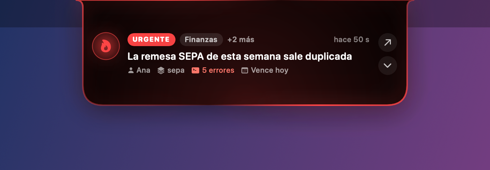
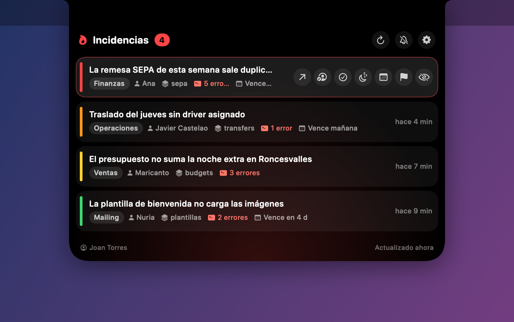

# Notchwatch

Notchwatch es una isla flotante, al estilo de la Dynamic Island del iPhone, que vive en el notch del Mac y avisa con animación y sonido cuando entra una incidencia nueva en Asana. Vigila los proyectos de incidencias de Tubuencamino: Ventas, Finanzas, Operaciones, Traslados, Mailing, Mi TBC y TBC Incidencias.

| Reposo | Aviso urgente | Desplegada |
|---|---|---|
|  |  |  |

> La CI regenera las capturas en cada push (artefacto `snapshots`).

## Qué hace

- **Píldora en el notch.** A la izquierda muestra un icono de estado con el color de la prioridad más alta pendiente; a la derecha, el contador de incidencias pendientes.
- **Aviso al entrar una incidencia.** La isla se transforma en una tarjeta que muestra:
  - prioridad y app;
  - asunto;
  - quién la reporta;
  - módulo;
  - errores de consola;
  - fecha de vencimiento.

  La acompaña un halo animado del color de la prioridad. Las de prioridad baja y media se recogen solas a los 6 segundos. Las altas y urgentes se quedan a la vista y repiten el sonido hasta que pasas el ratón por la isla.
- **Desplegada.** Al pasar el ratón por la isla, o con un clic, aparece la lista de pendientes con sus acciones rápidas:
  - abrir en Asana;
  - asignármela (además, pone el Estado en «En curso»);
  - pasar a Verificación;
  - posponer: 15 min, 1 h, 4 h o hasta mañana;
  - cambiar la fecha de vencimiento: atajos o un calendario;
  - cambiar la prioridad;
  - marcar como vista.
- **Sonido propio sintetizado.** Una campanita suave para prioridad baja y media, y tres notas más insistentes para alta y urgente. Se pueden silenciar y hay un modo «No molestar» con horario, en el que solo suenan las urgentes.
- **Icono en la barra de menús** con el contador y un menú para mostrar la isla, actualizar, pausar los avisos 1 h, abrir los ajustes y buscar actualizaciones.

## Instalación

1. Descarga el `.dmg` de la última versión en **Releases** y arrastra Notchwatch a **Aplicaciones**.
2. La app no está firmada con un certificado de Apple. La primera vez, haz **clic derecho → Abrir** y confirma. También puedes ejecutar:
   ```bash
   xattr -dr com.apple.quarantine /Applications/Notchwatch.app
   ```
3. Al abrirse por primera vez aparece la ventana de Ajustes: pega tu **token personal de Asana** y pulsa *Guardar y probar*.
   - Para crear el token, ve en Asana a *Mi configuración → Apps → Consola de desarrolladores → Token de acceso personal* (https://app.asana.com/0/my-apps).
   - El token solo se guarda en el **Llavero** de tu Mac.
4. Opcional: en *Ajustes → General*, activa **Iniciar Notchwatch al arrancar el Mac**.

> La app va firmada ad-hoc, así que tras actualizar macOS puede pedirte permiso para leer el token del Llavero. Pulsa «Permitir siempre».

## Cómo decide qué avisar

- Lee cada 20 s (configurable) la sección **Incidencias Detectadas** de cada proyecto activo.
- La primera vez que lee un proyecto, da por vistas las incidencias con más de 10 minutos y solo avisa de las recientes. Así no te inunda de avisos.
- Cada incidencia se avisa una vez por sesión. Si la pospones, vuelve a avisar cuando vence el plazo.
- «Marcar como vista» la quita de la lista sin tocar nada en Asana. El estado se guarda en `~/Library/Application Support/Notchwatch/state.json`.

## Probar sin Asana

- **Modo demo:**
  ```bash
  swift run Notchwatch --demo
  ```
  Genera incidencias falsas cada 12 s.
- **Desde la app:** en *Ajustes → Probar la isla* puedes simular una incidencia de cada prioridad. Solo existe en local.

## Desarrollo

Requisitos: macOS 13 o superior y Xcode 16 (Swift 5.9 o superior).

```bash
swift build                     # compila
swift test                      # tests del núcleo (cliente Asana, diff, sonido, horarios)
swift run Notchwatch --demo     # app en modo demo
scripts/bundle.sh               # build/Notchwatch.app (ad-hoc)
UNIVERSAL=1 scripts/bundle.sh   # app universal arm64 + x86_64
scripts/make-dmg.sh             # build/Notchwatch-<versión>.dmg + .sha256
build/Notchwatch.app/Contents/MacOS/Notchwatch --self-test           # smoke test
build/Notchwatch.app/Contents/MacOS/Notchwatch --snapshot capturas/  # PNG de cada estado
```

### Publicar una versión

```bash
git tag v0.1.0
git push origin v0.1.0
```

El workflow **Release**:
1. pasa los tests;
2. construye la app universal y le hace el self-test;
3. crea el DMG y publica la GitHub Release con el `.dmg` y su `.sha256`.

Los tags con guion (`v0.2.0-beta.1`) se publican como prerelease.

### Buscar actualizaciones desde la app

El repo es privado. Si guardas en *Ajustes → Actualizaciones* un token de GitHub de solo lectura (*fine-grained*, permiso *Contents: read* sobre este repo), la isla te avisa cuando hay una versión nueva. Sin token, *Buscar actualizaciones* abre la página de releases.

## Arquitectura

```
Sources/
  NotchwatchCore/          Solo Foundation. Se testea y compila también en Linux.
    AsanaClient            REST de Asana: lectura de Detectadas (paginada) y acciones.
    IncidentMonitor        Actor: poll en paralelo, línea base por proyecto, persistencia.
    IncidentDiffer         Qué es nuevo, qué está pendiente, snooze.
    SoundPolicy            Silencio, «No molestar» y repetición de urgentes.
    NotchwatchConfig       Proyectos, secciones y campos de Tubuencamino (GIDs).
  Notchwatch/              App macOS (SwiftUI + AppKit).
    NotchWindowController  NSPanel sobre el notch, hover y paso de clics.
    IslandView             Estados idle / peek / expanded con transiciones de muelle.
    IncidentRow            Fila con acciones rápidas.
    AppModel               Orquesta poll, avisos, sonidos, acciones y demo.
    SoundEngine            Sonidos sintetizados con AVAudioEngine.
    SettingsView           Token (Llavero), proyectos, sonido, pantalla, login.
Tests/NotchwatchCoreTests  XCTest con fixtures reales de la API de Asana.
scripts/                   bundle.sh, make-dmg.sh, make-icon.swift
.github/workflows/         ci.yml (build, tests, self-test, capturas) y release.yml (DMG)
```

## Privacidad

- El token de Asana solo se guarda en el Llavero y solo se envía a `app.asana.com`.
- No hay telemetría.
- Los logs van al sistema unificado de macOS (subsistema `com.joandev.notchwatch`).
